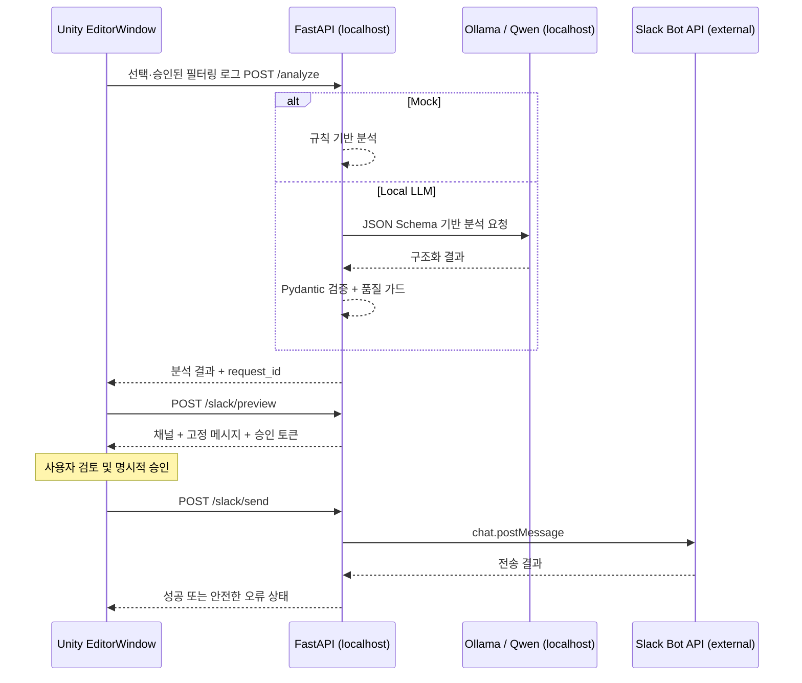

# Unity AI Log Analyzer 포트폴리오 정리

## 프로젝트 개요

- 프로젝트명: Unity AI Log Analyzer
- 적용 프로젝트: DiceAndDie
- 개발 목적: Unity 개발 과정에서 발생하는 오류의 수집, 분석 및 팀 공유 지원
- 핵심 기능: 에디터 로그 수집, 로컬 LLM 분석, 검토·승인 기반 Slack 공유
- 개발 환경: Unity 6000.0.32f1, Windows, Python/FastAPI, Ollama, Slack
- 개발 범위: 기존 게임 프로젝트에 독립적으로 추가한 Editor 확장과 로컬 자동화 서버

게임 런타임 코드, 씬, 프리팹과 리소스는 변경하지 않고 `Assets/Editor`와 `Tools/AILogAnalyzerServer` 경계에 구현했다. AI 모델을 직접 학습한 프로젝트가 아니라, Ollama를 통해 기존 `qwen2.5-coder:7b`를 안전한 개발 도구 흐름에 통합한 프로젝트다.

## 해결하려는 문제

- Unity Console에서 반복 오류를 직접 분류하고 같은 문제를 반복 확인해야 한다.
- Stack Trace와 발생 맥락을 바탕으로 초기 점검 항목을 정리하는 데 시간이 필요하다.
- 분석 결과를 팀원이 읽기 좋은 형태로 다시 정리해 공유해야 한다.
- 외부 LLM에 로그를 전송할 경우 사용자 경로, Token, 이메일 등 민감정보 노출 가능성이 있다.

도구는 중복 오류를 집계하고 개발자가 선택한 한 건만 전송한다. 로컬 Qwen이 원인 후보와 확인 절차를 구조화해 제공하고, 개발자가 내용을 확인한 뒤 승인한 결과만 Slack으로 공유한다. 실제 시간 절감률이나 생산성 향상 수치는 측정하지 않았으므로 제시하지 않는다.

## 핵심 구현 내용

### 1. Unity EditorWindow 기반 로그 수집

`Application.logMessageReceivedThreaded`에서 Error, Exception, Assert를 thread-safe queue에 적재하고 Editor update에서 프레임당 최대 100개를 처리한다. 고유 로그는 500개, 대기 큐는 2,000개로 제한했다. 메시지·Stack Trace·유형을 기준으로 중복 집계하며 검색, 유형 필터, 상세 보기와 테스트 로그 생성 기능을 제공한다.

### 2. FastAPI 분석 서버

Pydantic으로 입력 길이, 필수 필드, 시각 순서와 구조화 응답을 검증한다. Unity와의 HTTP 통신, 요청 크기 제한, timeout, 클라이언트 취소와 분석 결과 단기 이력을 처리한다. Mock 분석기와 Ollama 분석기를 동일 인터페이스 뒤에 분리했다.

### 3. Ollama + Qwen 로컬 분석

Ollama `/api/chat`에 System Prompt와 사용자 로그를 분리해 전달하고 JSON Schema 출력을 요구한다. Qwen 결과를 다시 Pydantic으로 검증한다. 사용자 코드, Unity Engine, Unity Editor, 외부 패키지와 위치 미상을 분류하며 Stack Trace 프레임을 근본 원인으로 단정하지 않는다. 실제 Assertion 평가에서 과도한 내부 구현 추정을 발견한 뒤 서버 측 품질 가드로 신뢰도와 핵심 안내를 보수적으로 정규화했다.

### 4. Slack Bot 공유

서버가 보관한 `request_id`만 미리보기로 변환하고, 5분 유효 무작위 승인 토큰을 발급한다. Unity에서 대상 채널과 실제 메시지를 검토한 후 별도 승인해야 `chat.postMessage`가 호출된다. 순차·동시 중복, 변조·만료 토큰, 권한·채널·rate limit·결과 불명 네트워크 오류를 처리한다.

## 시스템 구조

## 기술적 문제와 해결 과정

### Unity와 Python의 비동기 통신

Unity EditorWindow가 멈추지 않도록 `UnityWebRequest`를 비동기로 대기하고 CancellationToken으로 창 닫기, 항목 변경, 취소 버튼과 Play Mode 전환을 처리했다. 서버가 중지되어도 오류 상태만 UI에 표시하고 게임 런타임과 분리했다.

### Qwen JSON 응답 신뢰성

자유 형식 응답은 Unity UI와 호환되기 어렵기 때문에 Pydantic JSON Schema를 Ollama에 전달하고 반환값을 다시 검증했다. 잘못된 결과는 Mock 성공으로 위장하지 않고 명시적인 오류로 반환한다.

### 분석 결과의 불확실성

Unity Assertion 실제 평가에서 Qwen이 로그의 내부 메서드와 변수 값을 직접 점검 대상으로 단정하는 현상을 확인했다. 프롬프트의 사실/추정 구분을 강화하고, 관련 위치 표현과 신뢰도 제한 및 Assertion 전용 보수적 안내를 서버에서 적용했다.

### 개인정보 보호

Unity 전송 전과 Python 수신 후 두 번 필터링한다. 이메일, Windows/macOS/Linux 사용자 경로, Bearer/API/Slack Token, 비밀번호, Secret, IPv4와 URL을 합성 데이터로 검증했다. Slack에는 원본 Stack Trace 전체를 넣지 않으며 멘션과 링크 미리보기를 비활성화한다.

### Slack 승인과 중복 방지

분석 결과의 존재만으로 전송하지 않고 서버가 생성한 무작위 미리보기 토큰을 요구한다. 미리보기와 실제 payload를 동일하게 유지하고 동일 `request_id`의 동시 전송을 서버 lock과 상태 저장소로 차단했다. 저장소에는 TTL과 최대 개수를 적용했다.

## 테스트 결과 표현

이번 5단계에서 직접 수행한 결과:

- Python 자동 테스트 56개 통과
- Unity Editor C# 프로젝트 빌드 경고 0개, 오류 0개
- 실제 FastAPI 0.5.0 loopback 실행 및 HTTP 요청 성공
- 실제 `qwen2.5-coder:7b` Assertion 분석 및 품질 가드 재검증 성공
- Slack Fake client 기반 승인, 변조, 만료, 중복, 오류 처리 검증 성공

이번 단계에서 수행하지 않은 결과:

- 실제 Unity UI 클릭 기반 전체 흐름
- Unity 기존 Edit Mode/Play Mode 전체 회귀 테스트
- Python 3.11 환경 실행
- 실제 TestWS Slack 메시지 전송

이전 단계에 실제 Unity Qwen 표시와 TestWS 전송 성공 기록이 있지만, 이번 단계의 성공 수치로 다시 계산하지 않았다. 상세 근거는 `AILogAnalyzer_TestReport.md`에 기록했다.

## 포트폴리오용 스크린샷
### Screenshot 01 — Unity AI Log Analyzer 전체 화면

- 테스트 Error, Exception, Assert를 생성한다.
- 오류 목록, 검색창, 유형 필터, 중복 횟수와 선택한 상세 정보를 한 화면에 배치한다.
- 사용자 경로와 프로젝트 외 비공개 정보가 보이지 않는지 확인한다.

### Screenshot 02 — Python 및 Ollama 상태

- FastAPI와 Ollama를 먼저 실행한다.
- Unity의 Python 연결, Qwen 모델명·준비 상태와 Local LLM 모드가 보이게 촬영한다.
- 터미널을 함께 촬영한다면 환경변수 값과 Token이 화면에 없도록 한다.

### Screenshot 03 — 실제 Qwen 분석 결과

- 공개 가능한 합성 오류를 Local LLM으로 분석한다.
- 발생 영역, 신뢰도, 분석 근거, 예상 원인, 해결 방법, 추가 확인 사항과 영향 범위가 보이게 한다.
- 결과가 추정이라는 disclaimer를 포함한다.

### Screenshot 04 — Slack 메시지 전송

- 별도 테스트 채널에서 Unity 미리보기와 승인 후 한 건만 전송한다.
- Unity의 성공 상태와 Slack 채널의 동일 메시지를 각각 촬영한다.
- 워크스페이스 비공개 이름, 실제 Channel ID, 사용자 이름과 Token은 가린다.

### Screenshot 05 — 시스템 아키텍처

- 이 문서 또는 서버 README의 Mermaid 다이어그램을 렌더링한다.
- Unity/FastAPI/Ollama는 로컬 경계, Slack은 외부 서비스 경계임을 보이게 한다.

## 이력서용 소개 문구

Unity 6 게임 프로젝트에 독립형 AI Log Analyzer를 설계·구현했습니다. EditorWindow에서 오류를 수집·중복 집계하고, FastAPI와 Ollama 기반 Qwen2.5-Coder 7B로 구조화 분석한 뒤 사용자 승인 결과만 Slack에 공유했습니다. 이중 민감정보 필터, 응답 검증, 취소·타임아웃 및 중복 전송 방지와 56개 Python 자동 테스트를 적용했습니다.

## 포트폴리오용 상세 설명

DiceAndDie 개발 과정의 반복적인 오류 확인과 공유 작업을 지원하기 위해 기존 게임 코드와 분리된 Unity Editor 도구를 구현했다. Unity에서는 제한된 queue와 중복 집계로 Console 오류를 관리하고, 개발자가 선택·승인한 로그만 localhost FastAPI에 전달한다. 서버는 Mock 또는 Ollama의 기존 Qwen2.5-Coder 7B 모델을 사용하며, JSON Schema와 Pydantic 검증 및 서버 품질 가드로 결과 구조와 불확실성을 관리한다.

Slack 공유는 자동 알림이 아니라 미리보기와 이중 승인 흐름으로 설계했다. 환경변수의 고정 채널만 허용하고 무작위 승인 토큰, TTL, 동시성 lock과 중복 상태로 반복 게시를 차단한다. Unity와 Python 양쪽의 민감정보 필터, 프롬프트 인젝션 분리, 원본 Stack Trace 비게시 정책을 적용했다.

직접 구현한 범위는 Unity Editor 확장, HTTP DTO와 클라이언트, FastAPI API와 분석 추상화, 결과 검증·품질 가드, 보안 필터, Slack 승인 및 중복 방지, 자동 테스트와 기술 문서다. FastAPI, Pydantic, Ollama, Qwen, Slack SDK 등은 외부 오픈소스·서비스를 연동해 활용했으며 AI 모델 자체를 학습하거나 개발하지 않았다.

향후에는 Python 3.11 CI, Unity Editor 자동화 테스트, 실제 Slack sandbox 통합 테스트, 암호화된 영구 이력과 품질 평가 데이터셋 확장을 고려할 수 있다. Slash Command나 자동 코드 수정은 현재 범위에 포함하지 않는다.
