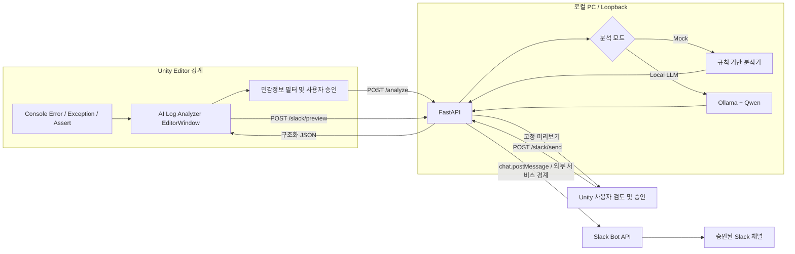

# Unity AI Log Analyzer

Unity 에디터가 사용자가 승인한 오류 하나를 전송하면 Mock 규칙 분석 또는 Ollama의 로컬 Qwen 모델 분석을 반환하는 FastAPI 서버다. 분석 결과는 다시 사용자가 미리보기와 대상 채널을 확인하고 승인한 경우에만 Slack으로 전송한다.

## 프로젝트 소개

- 프로젝트명: Unity AI Log Analyzer
- 적용 프로젝트: DiceAndDie
- 목적: Unity 오류 수집, 원인 검토, 팀 공유에 드는 반복 작업을 보조한다.
- 적용 범위: 기존 게임 런타임과 분리된 Unity Editor 확장 및 로컬 Python 도구다.

개발자는 Console 로그와 Stack Trace를 직접 찾아 원인을 검토하고 결과를 별도로 공유해야 한다. 이 도구는 Error·Exception·Assert를 중복 집계하고, 선택한 로그만 민감정보 필터링 후 로컬 Qwen으로 분석하며, 검토·승인된 결과만 Slack에 공유한다. LLM 결과는 추정이며 자동 코드 수정이나 확정 진단을 수행하지 않는다.

주요 기술은 Unity 6000.0.32f1, C#, EditorWindow, UnityWebRequest, Python, FastAPI, Pydantic, Ollama, Qwen2.5-Coder 7B, REST API, Slack SDK와 Slack Block Kit이다.

## 시스템 아키텍처



FastAPI와 Ollama는 loopback 주소를 사용한다. Slack만 외부 서비스이며 명시적 승인 이후에만 통신한다. 전체 프로젝트 소스나 전체 Console 기록을 자동 전송하지 않는다.

## 요구사항

- Python 3.11 이상
- Local LLM 모드 사용 시 Ollama
- 기본 모델: `qwen2.5-coder:7b`
- Slack 연동 사용 시 Bot User OAuth Token과 대상 Channel ID

7B 모델도 최초 로딩과 추론에 시간이 걸리고 수 GB 단위의 메모리를 사용할 수 있다. `qwen3-coder:30b` 같은 대형 모델은 훨씬 많은 RAM/VRAM이 필요하므로 시스템 사양을 확인한 뒤 설정해야 한다.

## Ollama 및 모델 준비

1. [Ollama 공식 다운로드 페이지](https://ollama.com/download)에서 Windows용 Ollama를 설치한다.
2. Ollama 앱을 실행하거나 터미널에서 로컬 서비스를 실행한다.
3. 모델은 사용자가 명시적으로 내려받는다.

```powershell
ollama pull qwen2.5-coder:7b
ollama list
```

서버는 모델을 자동 다운로드하거나 외부 모델로 대체하지 않는다. Ollama API 기본 주소는 `http://127.0.0.1:11434`다.

## Python 설치 및 실행

```powershell
cd Tools/AILogAnalyzerServer
py -3.11 -m venv .venv
.\.venv\Scripts\Activate.ps1
python -m pip install -r requirements-dev.txt
python -m uvicorn app.main:app --host 127.0.0.1 --port 8000
```

로컬 OpenAPI 문서는 `http://127.0.0.1:8000/docs`에서 확인할 수 있다. 인증이 없는 개발 서버이므로 외부 인터페이스에 바인딩하지 않는다.

## 환경변수

기본 모드는 Mock이다. PowerShell에서 서버를 실행하기 전에 필요한 값만 설정한다.

```powershell
$env:ANALYZER_MODE = "local_llm"
$env:OLLAMA_BASE_URL = "http://127.0.0.1:11434"
$env:OLLAMA_MODEL = "qwen2.5-coder:7b"
$env:OLLAMA_TIMEOUT_SECONDS = "120"
$env:LLM_MAX_OUTPUT_TOKENS = "1500"
$env:SLACK_ENABLED = "true"
$env:SLACK_BOT_TOKEN = "사용자가 직접 입력한 Bot User OAuth Token"
$env:SLACK_CHANNEL_ID = "사용자가 직접 확인한 Channel ID"
python -m uvicorn app.main:app --host 127.0.0.1 --port 8000
```

`ANALYZER_MODE`는 API 요청에 `analyzer_mode`가 없을 때의 기본값이다. Unity UI에서 선택한 모드는 요청 단위로 이 기본값을 재정의한다. `OLLAMA_MODEL`을 설치된 다른 모델 태그로 바꾸면 같은 API를 사용할 수 있다.

보안을 위해 `OLLAMA_BASE_URL`은 `127.0.0.1`, `localhost`, `::1`만 허용한다. 원격 주소는 설정 오류로 거부한다.

Slack이 필요하지 않으면 `SLACK_ENABLED=false`로 두거나 설정하지 않는다. 이 상태에서도 로그 수집, Mock 분석 및 Qwen 분석은 그대로 동작한다. Token과 Channel ID는 코드나 문서에 저장하지 않으며 서버 프로세스를 시작한 PowerShell의 환경변수에서만 읽는다. 환경변수를 바꾼 뒤에는 서버를 다시 시작해야 한다. `SLACK_APP_ID`는 메시지 대상이 아니므로 사용하지 않으며, 실제 전송 대상은 항상 서버의 `SLACK_CHANNEL_ID`다.

선택 설정으로 `UNITY_PROJECT_NAME`(기본값 `DiceAndDie`), `SLACK_TIMEOUT_SECONDS`(기본 10초), `ANALYSIS_HISTORY_TTL_SECONDS`(기본 3600초), `ANALYSIS_HISTORY_MAX_ENTRIES`(기본 200개)를 사용할 수 있다.

## Slack 앱 준비

1. Slack API 사이트에서 앱을 만들고 개발 워크스페이스 `TestWS`에 설치한다.
2. Bot Token Scope에 메시지 전송에 필요한 최소 권한인 `chat:write`를 추가한다.
3. Bot을 테스트 채널에 초대한다.
4. **Bot User OAuth Token**과 채널 세부정보의 **Channel ID**를 확인한다.
5. 위 환경변수를 같은 PowerShell 세션에 설정하고 FastAPI 서버를 시작한다.

메시지 읽기, 관리자 또는 Slash Command 권한은 4단계에 필요하지 않다. 앱 생성, 설치, Token 발급 및 채널 초대는 서버가 자동으로 수행하지 않는다.

## API

- `GET /health`: Python 서버, 기본 분석 모드, Ollama 연결, 모델 설치 상태 확인
- `POST /analyze`: `mock` 또는 `local_llm` 분석 실행
- `GET /slack/status`: Slack 활성화·설정·`auth.test` 인증 상태 확인. Token은 반환하지 않음
- `POST /slack/preview`: 서버가 보관한 `request_id`의 최종 메시지와 5분 유효 승인 토큰 생성
- `POST /slack/send`: 동일 미리보기 토큰의 고정된 내용을 설정된 채널로 한 번만 전송

Local LLM 요청은 Ollama `POST /api/chat`을 사용한다. System Prompt와 로그 JSON을 분리하고, `stream: false` 및 Pydantic에서 생성한 JSON Schema를 전달한다. 응답은 다시 Pydantic으로 검증하며 잘못된 결과를 자동 재요청하거나 Mock 결과로 위장하지 않는다.

### `GET /health`

서버 버전, 기본 분석 모드, Ollama 연결·모델 상태를 반환한다. Ollama가 중지되어도 FastAPI 자체 상태와 Mock 분석은 사용할 수 있다.

```json
{
  "status": "ok",
  "analyzer": "mock",
  "version": "0.5.0",
  "ollama_status": "ready",
  "ollama_model": "qwen2.5-coder:7b",
  "ollama_message": "Ollama와 모델이 분석 가능한 상태입니다."
}
```

### `POST /analyze`

오류 유형, 메시지, Stack Trace, 발생 횟수·시각과 `mock` 또는 `local_llm` 모드를 받는다. 응답은 기존 원인·해결·확인·영향 필드에 선택적 품질 정보인 `source_category`, `confidence`, `analysis_basis`를 추가한다. Stack Trace 프레임은 관련 위치로만 표시하며 근본 원인으로 확정하지 않는다.

```json
{
  "error_type": "Exception",
  "message": "NullReferenceException: Object reference not set",
  "stack_trace": "Game.Run() (at Assets/Game.cs:42)",
  "occurrence_count": 2,
  "first_occurred_at": "2026-10-25T10:00:00+09:00",
  "last_occurred_at": "2026-10-25T10:01:00+09:00",
  "analyzer_mode": "local_llm"
}
```

입력 누락·형식 오류는 422, 요청 크기 초과는 413, Ollama 연결·모델 오류는 503, 분석 timeout은 504로 처리한다.

```json
{
  "error_type": "Exception",
  "location": "관련 사용자 코드 프레임: Game.Run() (at Assets/Game.cs:42)",
  "probable_cause": "참조 객체가 null일 가능성이 있습니다.",
  "suggested_fix": "Inspector 할당과 초기화 경로를 확인하세요.",
  "checks_required": "재현 상태와 객체 생명주기를 확인하세요.",
  "impact_scope": "해당 호출 경로가 중단될 수 있습니다.",
  "disclaimer": "로그만 사용한 추정 분석입니다.",
  "is_mock": false,
  "analyzed_at": "2026-10-25T12:00:00Z",
  "request_id": "generated-uuid",
  "source_category": "user_code",
  "confidence": "medium",
  "analysis_basis": "Assets 아래의 관련 프레임이 확인되었습니다."
}
```

### `GET /slack/status`

Slack 활성화, Token·Channel 설정 여부와 `auth.test` 결과를 반환한다. Token 문자열은 반환하지 않는다.

```json
{
  "enabled": true,
  "token_configured": true,
  "channel_configured": true,
  "connection_status": "ready",
  "channel_id": "configured-channel-id",
  "status_message": "Slack Bot 인증이 확인되었습니다."
}
```

### `POST /slack/preview`

```json
{ "request_id": "analyze 응답의 UUID" }
```

서버 메모리에 남아 있는 분석만 허용하며 대상 `channel_id`, 실제 전송 문자열, 5분 유효 무작위 승인 토큰을 반환한다.

```json
{
  "request_id": "generated-uuid",
  "channel_id": "configured-channel-id",
  "preview_token": "temporary-random-approval-token",
  "preview_text": "Unity AI Log Analyzer\n프로젝트: DiceAndDie\n...",
  "expires_at": "2026-10-25T12:05:00Z"
}
```

### `POST /slack/send`

```json
{
  "request_id": "analyze 응답의 UUID",
  "preview_token": "preview 응답의 승인 토큰"
}
```

승인된 고정 payload를 환경변수의 채널로만 전송한다. 만료·변조·다른 요청의 토큰, 순차·동시 중복 요청은 거부한다. Slack 인증, 권한, 채널, rate limit, 네트워크 결과 불명 상태를 구분한다.

```json
{
  "success": true,
  "request_id": "generated-uuid",
  "channel_id": "configured-channel-id",
  "slack_message_ts": "Slack message timestamp",
  "sent_at": "2026-10-25T12:01:00Z",
  "error_code": "",
  "status_message": "Slack 메시지를 전송했습니다."
}
```

## Unity 테스트

1. Ollama와 FastAPI 서버를 실행한다.
2. Unity에서 `Tools > AI Log Analyzer`를 연다.
3. `연결 확인`으로 Python/Ollama/모델 상태를 확인한다.
4. 오류를 선택하고 필터링된 전송 미리보기를 검토한다.
5. 분석 모드에서 `Mock` 또는 `Local LLM`을 선택한다.
6. 분석 요청을 승인하고 결과를 확인한다.
7. 장시간 실행 중에는 `분석 취소`로 Unity HTTP 요청을 중단할 수 있다.
8. `Slack 상태 확인`으로 인증과 대상 채널을 확인한다.
9. 분석 완료 후 `Slack 메시지 미리보기 생성`을 눌러 외부 전송 내용을 검토한다.
10. `확인한 내용 Slack으로 전송`을 누르고 마지막 승인 대화상자를 확인한다.

Slack Token은 Unity로 전달되거나 표시되지 않는다. 원본 Stack Trace 전체도 Slack 메시지에 포함하지 않고 분석 위치만 사용한다. 로그와 분석 문자열은 서버에서 다시 민감정보를 필터링하며 `@channel`, `@here`, `@everyone` 및 Slack 특수 멘션 문법을 비활성화한다. 링크 미리보기 또한 비활성화한다.

분석 결과와 전송 상태는 단일 FastAPI 프로세스의 제한된 메모리에만 보관된다. 서버 재시작 시 이력과 중복 방지 상태가 초기화되며, 기본 보관 시간은 1시간이고 최대 200건이다. 네트워크 오류처럼 Slack 전송 성공 여부가 불명확한 경우 자동 재시도하지 않는다.

## 테스트

```powershell
python -m pytest
```

2026-10-25 검증 결과:

- 이번 5단계 실행에서 자동 테스트 56개 통과
- Mock 분석 및 API 호환성 통과
- Ollama 요청 생성, 구조화 응답, 모델 누락, 연결 실패, timeout, 잘못된 응답 테스트 통과
- Unity HTTP 연결이 끊어질 때 진행 중 분석 task 취소 테스트 통과
- 이번 실행에서 실제 로컬 `qwen2.5-coder:7b` Assertion 분석 성공 (`is_mock: false`)
- 품질 가드 적용 전 과도한 내부 구현 추정을 재현했고, 적용 후 `unity_editor`, `confidence: low`, 관련 프레임 한정 표현과 정보 부족 안내 확인
- Slack 비활성화/설정 누락/인증 실패/권한 부족/채널 없음/rate limit, 미리보기, Mock·Qwen 라벨, 메시지 길이, 민감정보와 전체 채널 멘션 제거, 실제 전송 payload 일치, 순차·동시 중복 방지 및 결과 불명 네트워크 오류 테스트 통과
- Slack SDK 호출은 Fake client로 검증했으며 자동 테스트에서 실제 Slack 채널에는 메시지를 보내지 않음
- Unity Editor C# 프로젝트 빌드 성공: 경고 0개, 오류 0개

테스트 머신에는 Python 3.10.7만 설치되어 있어 Python 자동 테스트는 3.10.7에서 수행했다. `py -0p`에서도 Python 3.11 설치를 확인하지 못했으므로 대상 환경인 Python 3.11 이상 실행은 미검증이다.

실제 `TestWS` 인증과 채널 전송은 실제 Token/Channel ID를 코드에 제공하지 않았으므로 미검증이다. Unity EditorWindow의 Slack 버튼·미리보기·승인 흐름도 수동 검증이 필요하다.

## 알려진 제한 사항

- Qwen 분석은 로그에 기반한 추정이며 정답을 보장하지 않는다.
- 로그가 짧거나 Stack Trace가 없으면 정확한 발생 영역과 원인을 특정하기 어렵다.
- 로컬 모델 실행에는 충분한 RAM/VRAM이 필요하고 모델·하드웨어에 따라 응답 시간이 달라진다.
- 분석 이력, Slack 미리보기와 중복 방지 상태는 제한된 프로세스 메모리에만 저장되어 서버 재시작 시 초기화된다.
- Slack 전송은 별도 인증정보, Bot의 채널 참여와 네트워크 연결이 필요하다.
- 현재 Python TestClient 조합에서 향후 `httpx2` 전환 관련 deprecation warning 1건이 발생한다.
